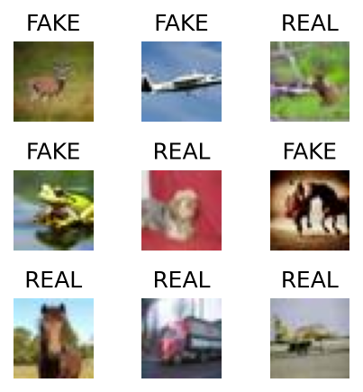
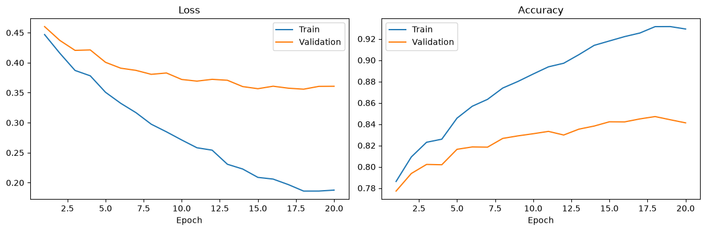
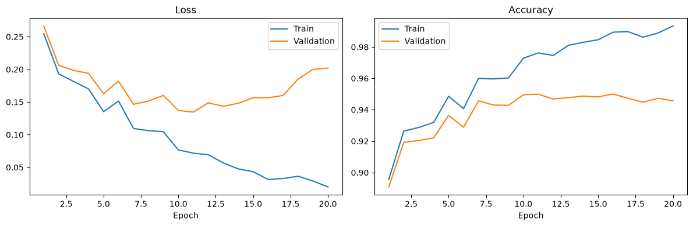

# AI Image Detector

A small PyTorch project that classifies images as **REAL** (camera photos) or **FAKE** (AI-generated). Two models are trained and compared on the same data:

- **MLP**: a fully connected network that treats each image as a flat vector of pixels
- **CNN**: a small convolutional network that learns local spatial patterns

The goal is to show how much an architecture that understands image structure (the CNN) beats one that doesn't (the MLP) at spotting generated images.

## Dataset

The data is the [CIFAKE](https://www.kaggle.com/datasets/birdy654/cifake-real-and-ai-generated-synthetic-images) dataset. Every image is a 32×32 RGB image. REAL images come from CIFAR-10, and FAKE images were generated with Stable Diffusion to look like the CIFAR-10 classes.

| Split | FAKE   | REAL   | Total   |
|-------|--------|--------|---------|
| Train | 50,000 | 50,000 | 100,000 |
| Test  | 10,000 | 10,000 | 20,000  |

The training set is split 90/10 into train (90,000) and validation (10,000). Pixels are normalized to `[-1, 1]`.



Expected layout:

```
data/
├── train/
│   ├── FAKE/
│   └── REAL/
└── test/
    ├── FAKE/
    └── REAL/
```

## Models

**MLP** (`mlp.ipynb`), about 1.64M parameters

```
Flatten(3×32×32 = 3072) → Linear(512) → ReLU → Dropout(0.3)
                         → Linear(128) → ReLU → Dropout(0.3)
                         → Linear(2)
```

**CNN** (`cnn.ipynb`), about 0.36M parameters

```
Conv(32) → ReLU → MaxPool    # 32×16×16
Conv(64) → ReLU → MaxPool    # 64×8×8
Conv(128) → ReLU → MaxPool   # 128×4×4
Flatten(2048) → Linear(128) → ReLU → Dropout(0.3) → Linear(2)
```

Training setup (same for both models):

- Loss: cross-entropy
- Optimizer: AdamW (`lr=3e-4`, `weight_decay=1e-2`)
- Batch size: 128
- Epochs: 20
- Device: Apple MPS when available, otherwise CPU

## Results

| Model | Parameters | Best val acc   | Test loss | Test acc   |
|-------|-----------:|---------------:|----------:|-----------:|
| MLP   | 1.64M      | 84.71% (ep 18) | 0.3631    | **84.23%** |
| CNN   | 0.36M      | 95.00% (ep 16) | 0.1721    | **95.17%** |

The CNN has about 4.6× fewer parameters but cuts the test error from about 16% to about 5%. Convolutions pick up local texture and artifact patterns that generated images leave behind, while the MLP only sees one long vector of pixels.

### MLP



Validation accuracy levels off around 84%, while training accuracy keeps rising to about 93%.

### CNN



Validation loss is lowest around epoch 11 and then climbs while training loss keeps falling, which is a clear sign of overfitting. Early stopping or data augmentation would likely help.

## Setup

```bash
python3 -m venv .venv
source .venv/bin/activate
pip install -r requirements.txt
```

Download CIFAKE into `data/` using the layout above, then open the notebooks:

```bash
jupyter lab
```

Run `mlp.ipynb` or `cnn.ipynb` from top to bottom. Each notebook trains its model, prints the per-epoch metrics and the test accuracy, and saves its plots to `images/`.

## Possible next steps

- Early stopping on validation loss
- Data augmentation (flips, small crops)
- Batch normalization and a deeper CNN
- Fine-tuning a pretrained backbone (for example ResNet-18)
- Saving the best checkpoint and adding a small inference script for single images
